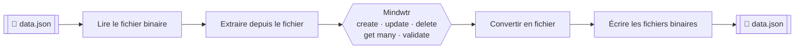

<p align="center">
  <picture>
    <source media="(prefers-color-scheme: dark)" srcset="./nodes/Mindwtr/mindwtr.dark.svg">
    
  </picture>
</p>

<h1 align="center">n8n-nodes-mindwtr-file</h1>

<p align="center">
  <strong>Gérez les tâches, projets et sous-tâches Mindwtr depuis vos workflows n8n —<br/>sans API, sans identifiants, simplement un fichier JSON.</strong>
</p>

<p align="center">
  <a href="https://www.npmjs.com/package/@taistudio/n8n-nodes-mindwtr-file"></a>
  <a href="https://www.npmjs.com/package/@taistudio/n8n-nodes-mindwtr-file"></a>
  <a href="https://docs.n8n.io/integrations/community-nodes/"></a>
  
  <a href="#licence"></a>
</p>

<p align="center">
  <a href="README.md">English</a> ·
  <a href="#à-propos">À propos</a> ·
  <a href="#installation">Installation</a> ·
  <a href="#prise-en-main">Prise en main</a> ·
  <a href="#référence-des-opérations">Opérations</a> ·
  <a href="#développement">Développement</a>
</p>

---

## À propos

**Mindwtr File** est un node communautaire n8n qui transforme un document JSON structuré — la base de données Mindwtr — en une véritable surface de gestion de tâches au cœur de vos workflows.

Plutôt que d'appeler un service distant, le node lit la base de données **depuis les données déjà présentes dans votre workflow** (un fichier lu depuis le disque, S3, HTTP, une charge utile de webhook…), applique l'opération choisie, puis renvoie le résultat **dans la forme exacte en entrée** — prêt à être réécrit dans un fichier `.json`.

- **Trois ressources** — `Task` (tâche), `Project` (projet) et `Subtask` (sous-tâche), soit 16 opérations au total.
- **Zéro identifiant** — tout est traité localement dans le workflow.
- **Compatible Cloud** — mode strict activé, conformité aux règles n8n Cloud pour les nodes communautaires.
- **Utilisable comme un outil** — branchez le node directement dans la liste d'outils d'un Agent IA.
- **Aller-retour sûr** — ce qui entre ressort avec la même structure, seules les données sont mises à jour.
- **Humainement lisible** — référencez n'importe quel élément par son ID **ou** par son nom (`Website Redesign`, `redesign`, `p1`…).

---

## Installation

Suivez [le guide officiel des nodes communautaires n8n](https://docs.n8n.io/integrations/community-nodes/installation/) :

1. Ouvrez **Settings → Community Nodes** dans votre instance n8n.
2. Sélectionnez **Install**.
3. Saisissez `@taistudio/n8n-nodes-mindwtr-file`.
4. Acceptez l'avertissement de risque et confirmez **Install**.

<details>
<summary><strong>Installation en ligne de commande</strong></summary>

```bash
# Dossier custom nodes par défaut (Docker / auto-hébergé)
npm install @taistudio/n8n-nodes-mindwtr-file --prefix /home/node/.n8n

# ou, à l'intérieur du conteneur n8n
n8n install:community-node @taistudio/n8n-nodes-mindwtr-file
```

Redémarrez ensuite n8n et retrouvez **Mindwtr** dans le panneau des nodes.
</details>

---

## Prise en main

### 1 · Le format des données

Le node fonctionne sur un document JSON Mindwtr. Exemple minimal et complet :

```json
{
  "tasks": [
    {
      "id": "t3",
      "title": "Draft project proposal",
      "status": "next",
      "tags": ["urgent"],
      "contexts": ["@work"],
      "projectId": "p1",
      "dueDate": "2025-11-26T12:00:00.000Z",
      "createdAt": "2025-11-24T09:30:00.000Z",
      "updatedAt": "2025-11-24T09:30:00.000Z",
      "subtasks": [
        { "id": "st_1", "title": "Outline the goals", "status": "completed" }
      ]
    },
    {
      "id": "t1",
      "title": "Call Mom",
      "status": "inbox",
      "contexts": ["@home"]
    }
  ],
  "projects": [
    { "id": "p1", "title": "Website Redesign", "status": "active", "color": "#3b82f6" }
  ],
  "settings": {}
}
```

| Clé          | Requis | Remarques                                              |
| ------------ | :----: | ------------------------------------------------------ |
| `tasks`      |   ✅   | Chaque tâche doit avoir un `id` et un `title`.         |
| `projects`   |   ✅   | Chaque projet doit avoir un `id` et un `title`.        |
| `settings`   |   ⬜   | Objet libre, conservé tel quel s'il était présent.     |
| `subtasks`   |   ⬜   | Imbriquées dans leur tâche parente.                    |
| `projectId`  |   ⬜   | Associe une tâche à un projet.                         |

> Le node tolère l'**emplacement** des données : un document de premier niveau, un conteneur `{ "data": … }` (comme celui renvoyé par *Extract From File*), une liste brute de tâches ou une tâche unique sont tous détectés automatiquement — jusqu'à 3 niveaux d'imbrication.

### 2 · Le schéma du workflow



1. **Lire** le fichier JSON dans une propriété binaire n8n (par défaut : `data`).
2. **Transformer** avec le node Mindwtr — créer une tâche, mettre à jour un projet, valider une sous-tâche…
3. **Écrire** la sortie dans un fichier avec le node suivant. Le JSON peut être sauvegardé tel quel, quelle que soit l'opération effectuée.

### 3 · Un exemple concret

> *« Un webhook reçoit une nouvelle action à mener → on l'enregistre dans le fichier Mindwtr. »*

| # | Node                   | Configuration                                                                     |
| - | ---------------------- | --------------------------------------------------------------------------------- |
| 1 | **Webhook**            | POST `/new-task`, méthode `POST`                                                   |
| 2 | **Mindwtr**            | Ressource `Task` → Opération `Create`, Title `={{ $json.body.title }}`             |
| 3 | **Convert To File**    | Opération *To JSON*                                                                |
| 4 | **Write Binary Files** | File Name `data.json`, Property `data`                                             |

Chaque exécution ajoute la nouvelle tâche (avec un `id` généré automatiquement et les horodatages `createdAt` / `updatedAt`) et renvoie toute la base mise à jour.

---

## Garanties de sortie

### Même forme en entrée, même forme en sortie

Chaque opération — **Get Many** inclus — renvoie les données dans la **forme JSON exacte de l'entrée** :

- les mêmes clés de premier niveau : un conteneur comme `data` (issu d'*Extract From File*) reste en place, et les données sont réécrites là où elles ont été trouvées ;
- chaque clé supplémentaire de l'entrée (métadonnées, etc.) est conservée intacte ;
- seules les données (`tasks`, `projects` et `settings`) sont mises à jour ;
- `settings` n'est présent que si l'entrée l'avait ;
- des données fournies sous forme de chaîne JSON sont renvoyées sous forme de chaîne JSON.

### Get Many renvoie une vue filtrée

**Get Many** conserve cette même forme, la liste étant réduite aux entrées correspondant aux filtres et à la limite :

| Ressource | Résultat                                                                                                     |
| --------- | ------------------------------------------------------------------------------------------------------------ |
| Task      | `tasks` ne contient que les entrées correspondantes, `projects` reste complet pour référence.                 |
| Project   | `projects` ne contient que les entrées correspondantes, `tasks` reste complet pour référence.                 |
| Subtask   | `tasks` ne contient que la tâche parente sélectionnée, avec ses `subtasks`.                                   |

### Les échecs ne détruisent jamais vos données

Si une opération échoue alors que **Always Output Data** est activé, la forme de l'entrée est préservée et une clé `error` est ajoutée — une exécution en échec ne remplace jamais votre base par un simple objet d'erreur.

---

## Référencer un élément par son ID **ou** par son nom

Champ qui attend un ID (tâche, projet ou sous-tâche) accepte aussi le **nom** tel qu'il figure dans le fichier JSON :

| Vous saisissez                           | Se résout en                                          |
| ---------------------------------------- | ----------------------------------------------------- |
| `p1`                                     | l'ID exact                                            |
| `website redesign`                       | nom exact, insensible à la casse                       |
| `redesign`                               | le nom unique contenant votre saisie                  |
| *(vide)*                                 | détection automatique depuis l'élément d'entrée        |
| plusieurs correspondances / nom inconnu  | une erreur listant tous les noms **et** leurs ID       |

Ainsi, une exécution en échec sert aussi de liste des éléments disponibles — plus besoin d'ouvrir le fichier pour trouver la bonne référence.

**Sélecteurs *From List*** — chaque localisateur propose aussi un mode *From List* recherchable, alimenté par les données présentes sur l'entrée du node (100 entrées par page, filtrables pendant la saisie). Si vos données sont imbriquées, indiquez la bonne propriété via l'option **List Source** (par défaut : `={{ $json }}`, par ex. `={{ $json.data }}` pour la sortie d'*Extract From File*).

---

## Référence des opérations

### Task (tâche)

| Opération               | Rôle                                     | Paramètres                                                                    |
| ----------------------- | ---------------------------------------- | ----------------------------------------------------------------------------- |
| **Create**              | Ajouter une tâche                        | `Title`* · Status · Tags · Contexts · Due Date · Project                      |
| **Update**              | Modifier une tâche existante             | `Task`* · Title · Status · Project · Tags · Contexts · Due Date               |
| **Delete**              | Supprimer une tâche                      | `Task`*                                                                       |
| **Get Many**            | Récupérer des tâches                     | Filtres : Status, Project · Return All / Limit                                |
| **Validate**            | Marquer une tâche comme faite ou non     | `Task`* · `Completed`                                                         |
| **Attach to Project**   | Associer une tâche à un projet           | `Task`* · `Project`*                                                          |
| **Detach From Project** | Retirer l'association à un projet        | `Task`*                                                                       |

### Project (projet)

| Opération    | Rôle                                        | Paramètres                              |
| ------------ | ------------------------------------------- | --------------------------------------- |
| **Create**   | Ajouter un projet                           | `Title`* · Status · Color                |
| **Update**   | Modifier un projet existant                 | `Project`* · Title · Status · Color      |
| **Delete**   | Supprimer un projet (ses tâches sont détachées) | `Project`*                           |
| **Get Many** | Récupérer des projets                       | Return All / Limit                       |

### Subtask (sous-tâche)

| Opération    | Rôle                                        | Paramètres                              |
| ------------ | ------------------------------------------- | --------------------------------------- |
| **Create**   | Ajouter une sous-tâche à une tâche          | `Task`* · `Title`*                       |
| **Update**   | Modifier le titre d'une sous-tâche          | `Task`* · `Subtask`* · `Title`*          |
| **Delete**   | Supprimer une sous-tâche                    | `Task`* · `Subtask`*                     |
| **Get Many** | Lister les sous-tâches d'une tâche          | `Task`* → la tâche parente et ses sous-tâches |
| **Validate** | Marquer une sous-tâche comme faite ou non   | `Task`* · `Subtask`* · `Completed`       |

`*` requis — laissez-le vide pour détecter automatiquement l'élément depuis les données d'entrée.

### Statuts

| Ressource | Valeurs                                                     | Défaut    |
| --------- | ----------------------------------------------------------- | --------- |
| Task      | `inbox` · `next` · `someday` · `waiting` · `completed`      | `inbox`   |
| Project   | `active` · `archived` · `completed`                         | `active`  |
| Subtask   | `needsAction` · `completed` *(géré par **Validate**)*       | automatique |

### À retenir

- **IDs et horodatages automatiques** — chaque nouvel élément reçoit un `id` unique (`t_…`, `p_…`, `st_…`) ainsi que `createdAt` / `updatedAt` ; toute mise à jour rafraîchit `updatedAt`.
- **Supprimer un projet** le retire et efface `projectId` sur les tâches qui le référençaient.
- **Une seule base par exécution** — la base est analysée une seule fois depuis le premier élément d'entrée puis partagée : plusieurs opérations enchaînées dans une même exécution se voient mutuellement leurs changements.
- **Aucun identifiant requis** — le node ne traite que des données déjà présentes dans le workflow.

---

## Compatibilité

| Exigence          | Valeur                                        |
| ----------------- | --------------------------------------------- |
| **n8n**          | v1.0.0 ou supérieur                           |
| **API du node**  | Version 1                                     |
| **Mode strict**  | Activé (éligible au n8n Cloud)                |
| **Identifiants** | Aucun                                         |
| **Version node** | 26.11.1                                       |
| **Catégories**   | Productivity, Development                     |

---

## Développement

Construit avec le CLI officiel [`n8n-node`](https://docs.n8n.io/integrations/creating-nodes/build/).

```bash
git clone https://github.com/TaiStudio/n8n-nodes-mindwtr-file.git
cd n8n-nodes-mindwtr-file
npm install

npm run dev        # n8n avec hot reload sur http://localhost:5678
npm run build      # compilation dans dist/ pour la distribution
npm run lint       # vérification du style (--fix pour corriger)
npm run release    # build, lint, changelog, tag & publication sur npm
```

| Chemin                                | Rôle                                        |
| ------------------------------------- | ------------------------------------------- |
| `nodes/Mindwtr/Mindwtr.node.ts`       | Le node (ressources, opérations, exécution) |
| `nodes/Mindwtr/mindwtr.svg`           | Icône (version claire + sombre)             |
| `data.json`                           | Base Mindwtr d'exemple pour les tests locaux |
| `package.json` → `n8n`                | Nodes et identifiants enregistrés           |
| `CHANGELOG.md`                        | Historique des versions                     |

Merci de lire [AGENTS.md](AGENTS.md) et `.agents/workflow.md` avant de contribuer.

---

## Support & contribution

- 🐛 **Bugs et fonctionnalités** → [ouvrir une issue](https://github.com/TaiStudio/n8n-nodes-mindwtr-file/issues)
- 🔒 **Sécurité** → voir [SECURITY.md](SECURITY.md)
- 📦 **Notes de version** → [CHANGELOG.md](CHANGELOG.md)
- 💖 **Soutenir le projet** → [GitHub Sponsors](https://github.com/sponsors/LeGitHubDeTai) · [Buy Me a Coffee](https://www.buymeacoffee.com/taistudio)

---

## Licence

MIT © Tai Studio
