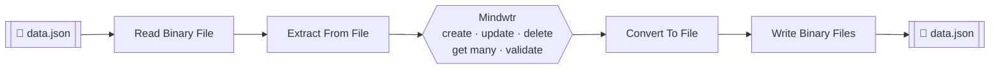

<p align="center">
  <picture>
    <source media="(prefers-color-scheme: dark)" srcset="./nodes/Mindwtr/mindwtr.dark.svg">
    
  </picture>
</p>

<h1 align="center">n8n-nodes-mindwtr-file</h1>

<p align="center">
  <strong>Manage Mindwtr tasks, projects and subtasks from your n8n workflows —<br/>no API, no credentials, just a plain JSON file.</strong>
</p>

<p align="center">
  <a href="https://www.npmjs.com/package/@taistudio/n8n-nodes-mindwtr-file"></a>
  <a href="https://www.npmjs.com/package/@taistudio/n8n-nodes-mindwtr-file"></a>
  <a href="https://docs.n8n.io/integrations/community-nodes/"></a>
  
  <a href="#license"></a>
</p>

<p align="center">
  <a href="README.md"><strong>English</strong></a> ·
  <a href="README.fr.md">Français</a>
</p>

<p align="center">
  <a href="#about">About</a> ·
  <a href="#installation">Installation</a> ·
  <a href="#getting-started">Getting started</a> ·
  <a href="#operations-reference">Operations</a> ·
  <a href="#development">Development</a>
</p>

---

## About

**Mindwtr File** is an n8n community node that turns a structured JSON document — the Mindwtr database — into a full task-management surface inside your workflows.

Instead of calling a remote service, the node reads the database **from the data already flowing in your workflow** (a file read from disk, S3, HTTP, a webhook payload…), applies the operation you selected, and hands the result back **in the exact same shape** — ready to be written straight back to a `.json` file.

- **Three resources** — `Task`, `Project` and `Subtask`, with 16 operations in total.
- **Zero credentials** — everything is processed locally in the workflow.
- **Cloud compatible** — strict mode enabled, follows the n8n Cloud community-node rules.
- **Usable as a tool** — plug the node directly into an AI Agent's tool list.
- **Round-trip safe** — whatever goes in comes back with the same structure, only the data is updated.
- **Human friendly** — reference any item by its ID *or* by its name (`Website Redesign`, `redesign`, `p1`…).

---

## Installation

Follow the [official n8n community nodes guide](https://docs.n8n.io/integrations/community-nodes/installation/):

1. Open **Settings → Community Nodes** in your n8n instance.
2. Select **Install**.
3. Enter `@taistudio/n8n-nodes-mindwtr-file`.
4. Accept the risk disclaimer and confirm **Install**.

<details>
<summary><strong>Install from the command line</strong></summary>

```bash
# Docker / self-hosted default custom nodes folder
npm install @taistudio/n8n-nodes-mindwtr-file --prefix /home/node/.n8n

# or, inside the n8n container
n8n install:community-node @taistudio/n8n-nodes-mindwtr-file
```

Then restart n8n and look for **Mindwtr** in the node panel.
</details>

---

## Getting started

### 1 · The data format

The node operates on a Mindwtr JSON document. A minimal, complete example:

```json
{
  "tasks": [
    {
      "id": "t3",
      "title": "Draft project proposal",
      "status": "next",
      "tags": ["urgent"],
      "contexts": ["@work"],
      "projectId": "p1",
      "dueDate": "2025-11-26T12:00:00.000Z",
      "createdAt": "2025-11-24T09:30:00.000Z",
      "updatedAt": "2025-11-24T09:30:00.000Z",
      "subtasks": [
        { "id": "st_1", "title": "Outline the goals", "status": "completed" }
      ]
    },
    {
      "id": "t1",
      "title": "Call Mom",
      "status": "inbox",
      "contexts": ["@home"]
    }
  ],
  "projects": [
    { "id": "p1", "title": "Website Redesign", "status": "active", "color": "#3b82f6" }
  ],
  "settings": {}
}
```

| Key         | Required | Notes                                                        |
| ----------- | :------: | ------------------------------------------------------------ |
| `tasks`     |    ✅    | Every task needs an `id` and a `title`.                      |
| `projects`  |    ✅    | Every project needs an `id` and a `title`.                   |
| `settings`  |    ⬜    | Free-form object, preserved as-is when present.              |
| `subtasks`  |    ⬜    | Nested inside their parent task.                             |
| `projectId` |    ⬜    | Links a task to a project.                                   |

> The node is tolerant about **where** the data sits: a top-level document, a `{ "data": … }` wrapper (as returned by *Extract From File*), a bare list of tasks, or a single task are all detected automatically — up to 3 levels of nesting.

### 2 · The workflow pattern



1. **Read** the JSON file into an n8n binary property (default: `data`).
2. **Transform** it with the Mindwtr node — create a task, update a project, validate a subtask…
3. **Write** the output back to a file with the next node. The JSON can be saved as-is, whatever operation was run.

### 3 · A concrete example

> *“A webhook receives a new action item → store it in the Mindwtr file.”*

| # | Node                     | Configuration                                                            |
| - | ------------------------ | ------------------------------------------------------------------------ |
| 1 | **Webhook**              | POST `/new-task`, method `POST`                                          |
| 2 | **Mindwtr**              | Resource `Task` → Operation `Create`, Title `={{ $json.body.title }}`     |
| 3 | **Convert To File**      | Operation *To JSON*                                                       |
| 4 | **Write Binary Files**   | File Name `data.json`, Property `data`                                   |

Every run appends the new task (with an auto-generated `id` and `createdAt` / `updatedAt` timestamps) and returns the whole updated database.

---

## Output guarantees

### Same shape in, same shape out

Every operation — including **Get Many** — returns data in the **exact same JSON shape as the input**:

- the same top-level keys: a wrapper such as `data` (from *Extract From File*) stays in place, and the data is written back where it was found;
- every extra key of the input (metadata, etc.) is kept untouched;
- only the data itself (`tasks`, `projects` and `settings`) is updated;
- `settings` is only present when the input had it;
- data provided as a JSON string is handed back as a JSON string.

### Get Many returns a filtered view

**Get Many** keeps that same shape, with the list reduced to the entries matching the filters and limit:

| Resource | Result                                                                                                     |
| -------- | ---------------------------------------------------------------------------------------------------------- |
| Task     | `tasks` only contains the matching entries, `projects` stays complete for reference.                       |
| Project  | `projects` only contains the matching entries, `tasks` stays complete for reference.                       |
| Subtask  | `tasks` only contains the selected parent task, with its `subtasks`.                                        |

### Failures never destroy your data

If an operation fails while **Always Output Data** is enabled, the input shape is preserved and an `error` key is added — a failed run never replaces your database with a bare error object.

---

## Referencing items by ID **or** by name

Every field that expects an ID (task, project or subtask) also accepts the **name** as found in the JSON file:

| You type                                | Resolves to                                       |
| --------------------------------------- | ------------------------------------------------- |
| `p1`                                    | the exact ID                                      |
| `website redesign`                      | exact name, case-insensitive                       |
| `redesign`                              | the single name containing what you typed          |
| *(empty)*                               | auto-detection from the input item                 |
| several matches / unknown name          | an error listing every available name **and** ID   |

So a failed run always doubles as a list of what's available — no need to open the file to find the right reference.

**From List pickers** — every locator also offers a searchable *From List* mode, populated from the data present on the node's input (100 entries per page, filterable as you type). If your data is nested, point the **List Source** option at the right property (default: `={{ $json }}`, e.g. `={{ $json.data }}` for an *Extract From File* payload).

---

## Operations reference

### Task

| Operation            | What it does                            | Parameters                                                                     |
| -------------------- | --------------------------------------- | ------------------------------------------------------------------------------ |
| **Create**           | Add a new task                          | `Title`* · Status · Tags · Contexts · Due Date · Project                       |
| **Update**           | Modify an existing task                 | `Task`* · Title · Status · Project · Tags · Contexts · Due Date                |
| **Delete**           | Remove a task                           | `Task`*                                                                        |
| **Get Many**         | Retrieve tasks                          | Filters: Status, Project · Return All / Limit                                  |
| **Validate**         | Complete or un-complete a task          | `Task`* · `Completed`                                                          |
| **Attach to Project**| Assign a task to a project              | `Task`* · `Project`*                                                           |
| **Detach From Project** | Remove the project association       | `Task`*                                                                        |

### Project

| Operation      | What it does                              | Parameters                                   |
| -------------- | ----------------------------------------- | -------------------------------------------- |
| **Create**     | Add a new project                         | `Title`* · Status · Color                     |
| **Update**     | Modify an existing project                | `Project`* · Title · Status · Color           |
| **Delete**     | Remove a project (its tasks are detached) | `Project`*                                    |
| **Get Many**   | Retrieve projects                         | Return All / Limit                            |

### Subtask

| Operation      | What it does                              | Parameters                                   |
| -------------- | ----------------------------------------- | -------------------------------------------- |
| **Create**     | Add a subtask to a task                   | `Task`* · `Title`*                            |
| **Update**     | Modify a subtask title                    | `Task`* · `Subtask`* · `Title`*               |
| **Delete**     | Remove a subtask                          | `Task`* · `Subtask`*                          |
| **Get Many**   | List the subtasks of a task               | `Task`* → the parent task with its subtasks   |
| **Validate**   | Complete or un-complete a subtask         | `Task`* · `Subtask`* · `Completed`            |

`*` required — leave it empty to auto-detect the item from the input data.

### Statuses

| Resource | Values                                                     | Default   |
| -------- | ---------------------------------------------------------- | --------- |
| Task     | `inbox` · `next` · `someday` · `waiting` · `completed`     | `inbox`   |
| Project  | `active` · `archived` · `completed`                        | `active`  |
| Subtask  | `needsAction` · `completed` *(managed by **Validate**)*    | automatic |

### Good to know

- **IDs and timestamps are automatic** — new entries get a unique `id` (`t_…`, `p_…`, `st_…`) plus `createdAt` / `updatedAt`; every mutation refreshes `updatedAt`.
- **Deleting a project** removes it and clears `projectId` on the tasks that referenced it.
- **One database per run** — the database is parsed once from the first input item and shared, so several chained operations in a single run see each other's changes.
- **No credentials required** — the node only processes data already present in the workflow.

---

## Compatibility

| Requirement        | Value                                          |
| ------------------ | ---------------------------------------------- |
| **n8n**           | v1.0.0 or higher                               |
| **Node API**      | Version 1                                      |
| **Strict mode**   | Enabled (n8n Cloud eligible)                   |
| **Credentials**   | None                                           |
| **Node version**  | 26.11.1                                        |
| **Categories**    | Productivity, Development                      |

---

## Development

Built with the official [`n8n-node`](https://docs.n8n.io/integrations/creating-nodes/build/) CLI.

```bash
git clone https://github.com/TaiStudio/n8n-nodes-mindwtr-file.git
cd n8n-nodes-mindwtr-file
npm install

npm run dev        # n8n with hot reload on http://localhost:5678
npm run build      # compile to dist/ for distribution
npm run lint       # check code style (--fix to auto-fix)
npm run release    # build, lint, changelog, tag & publish to npm
```

| Path                                   | Purpose                                    |
| -------------------------------------- | ------------------------------------------ |
| `nodes/Mindwtr/Mindwtr.node.ts`        | The node (resources, operations, execution) |
| `nodes/Mindwtr/mindwtr.svg`            | Icon (light + dark variant)                 |
| `data.json`                            | Sample Mindwtr database for local testing   |
| `package.json` → `n8n`                 | Registered nodes & credentials              |
| `CHANGELOG.md`                         | Release history                            |

Please read [AGENTS.md](AGENTS.md) and `.agents/workflow.md` before contributing.

---

## Support & contributing

- 🐛 **Bug reports & feature requests** → [open an issue](https://github.com/TaiStudio/n8n-nodes-mindwtr-file/issues)
- 🔒 **Security** → see [SECURITY.md](SECURITY.md)
- 📦 **Release notes** → [CHANGELOG.md](CHANGELOG.md)
- 💖 **Support the project** → [GitHub Sponsors](https://github.com/sponsors/LeGitHubDeTai) · [Buy Me a Coffee](https://www.buymeacoffee.com/taistudio)

---

## License

MIT © Tai Studio
